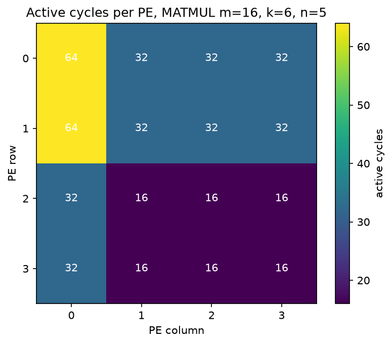

# Systolic-array matrix-multiply accelerator

A weight-stationary systolic-array accelerator (TPU-like) written in Chisel 3.6.1
for the Nexys4 DDR FPGA. A C++ host sends int8 matrices over UART (2 Mbaud),
starts the product, and reads back int32 results (or requantized int8). Inputs
are int8, accumulation is int32, the board clock is 100 MHz.

## Features

- Parameterized N×N array; `EmitBoard` builds 2x2, 4x4 (default) and 8x8.
- Weight double buffering: the next tile's weights load while the current tile
  computes, and tiles run back to back.
- Tiling of arbitrary m×k×n products (m up to 64 per MATMUL; the host splits larger A).
- Requantization (int32 to int8 by right shift), ReLU and Leaky ReLU
  (power-of-two slope).
- Hardware bias: int32 per output column, added at the first K-tile.
- On-chip layer chaining (`toInput`): a layer's int8 output is written back to
  the input memory and feeds the next MATMUL without going through the host.
- Cycle and PE-utilization counters, returned by STATUS.

## Architecture

```
host -- UART --> UartRx -> RxFifo -> CommandDecoder -> Sequencer -> DataMover -> SystolicArray -> Accumulators
                                          |  ^                                                        |
                                          v  |                                                        v
host <- UART <-- UartTx <------------- READ / STATUS replies <------------------------------- UnifiedBuffer
```

| Block | Role |
|---|---|
| `UartRx`, `RxFifo`, `UartTx` | Serial line, with a receive FIFO |
| `CommandDecoder` | Parses frames into buffer writes, bias writes, MATMUL instructions, READ and STATUS replies |
| `Sequencer` | Splits a MATMUL into tiles and issues them back to back |
| `DataMover` | Streams weights and activations from the buffer into the array |
| `SystolicArray` | The PE grid, with input skew and output de-skew |
| `Accumulators` | Sum partial results across K-tiles; add bias; requantize, ReLU |
| `UnifiedBuffer` | Banked input memory (A and B, 4096 elements) and result memory |

The core is `Tpu` (`src/main/scala/tpu/Tpu.scala`: `TpuCore` plus the UART), wrapped by
`BoardTop` (clock generation, pins) for the FPGA.
The wire protocol (WRITE, READ, MATMUL, STATUS, BIAS) is documented in
[`HostProtocol.scala`](src/main/scala/tpu/io/HostProtocol.scala).

## Repository layout

| Path | Content |
|---|---|
| `src/main/scala/` | Chisel sources: `ifaces/` (`SAConfig`, interfaces), `tpu/` (core, `board/`, `io/`, `compute/`, `memory/`) |
| `src/test/` | Scala tests, including the Scala reference model `tpu.ref.RefModel` and shared `ref_vectors.txt` |
| `host/` | C++ host library, tests, demo and tools ([host/README.md](host/README.md)) |
| `fpga/` | Vivado scripts, pin constraints, timing notes |
| `scripts/` | Python: digits training (`train_digits.py`), PE heatmap (`pe_heatmap.py`) |
| `docs/` | [Design decisions](docs/design-decisions.md) and figures |

## Build and test

```
sbt test                              # all Scala tests (chiseltest/Treadle; CI runs the same)
sbt "runMain tpu.board.EmitBoard"     # generated/4x4/BoardTop.v; argument: 2x2, 4x4 or 8x8
```

On the board: `vivado -mode batch -source fpga/build.tcl -tclargs 4x4` builds the
bitstream, `fpga/program.tcl` loads it. The C++ host builds with CMake on
Windows, macOS and Linux. Details, port names and board tests are in
[host/README.md](host/README.md).

## Demo: handwritten digits

A 64-16-10 MLP on scikit-learn's 8x8 digits. Layer 1 uses bias, requantization
and Leaky ReLU (slope 1/8) and stays on chip; layer 2 uses bias and returns
int32 logits. `host/cpp/demo/digits_model.json` is committed, so the demo needs
no Python. To retrain (repository root):

```
python3 -m venv .venv; .venv/bin/pip install -r scripts/requirements.txt
.venv/bin/python scripts/train_digits.py
```

Run it from `host/cpp/` after building the host: `./build/run_mlp` (software
FakeTpu), or `TPU_PORT=COM3 TPU_CONFIG=../../build/4x4/config.json ./build/run_mlp`
on the board.

| Model | Accuracy (450 test digits) |
|---|---|
| Float | 96.67 % |
| int8 pipeline (simulation) | 96.44 % |
| Accelerator (FakeTpu, bit-exact) | 434 / 450 = 96.44 % |

## Performance

`./build/run_board` (in `host/cpp/`) runs random int8 square products of size 4
to 32 on the board, checks them against the reference model, and reports cycles,
utilization and MAC/s. The table below is the **FakeTpu cycle model** on the 4x4
array at 100 MHz, not a hardware measurement; run `run_board` with a board
attached for real numbers.

| Size | Cycles | Busy PE-cycles | Utilization | MAC/s |
|---|---|---|---|---|
| 4 | 15 | 64 | 26.7 % | 4.27e8 |
| 8 | 76 | 512 | 42.1 % | 6.74e8 |
| 16 | 432 | 4096 | 59.3 % | 9.48e8 |
| 32 | 2752 | 32768 | 74.4 % | 1.19e9 |

Utilization grows with size because the fixed fill/drain latency of the array
(`rows + cols - 1` cycles per tile) is spread over more rows.

## PE heatmap



One ragged MATMUL (16x6x5) on the 4x4 array: k and n pad to 8, so some PE rows
and columns idle in some tiles, and only 480 of the 1024 PE-cycles are useful.
Regenerate with `sbt "testOnly tpu.PeHeatmapSpec"` then `python scripts/pe_heatmap.py`.

## Design decisions

What was added for the final version, the alternatives we considered, and why:
[docs/design-decisions.md](docs/design-decisions.md).

