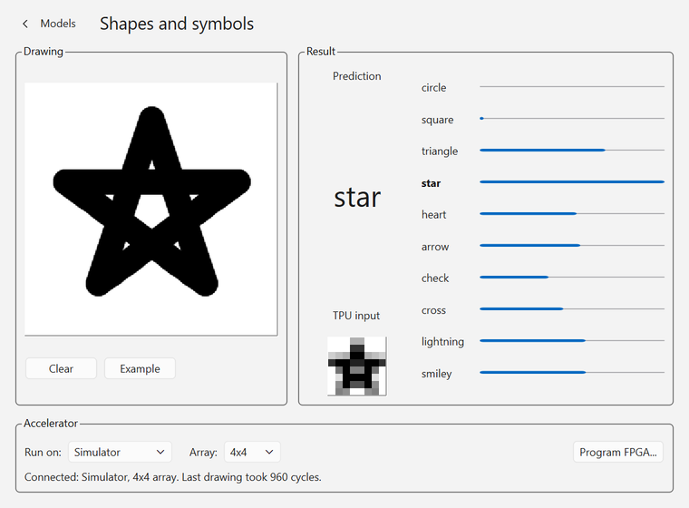
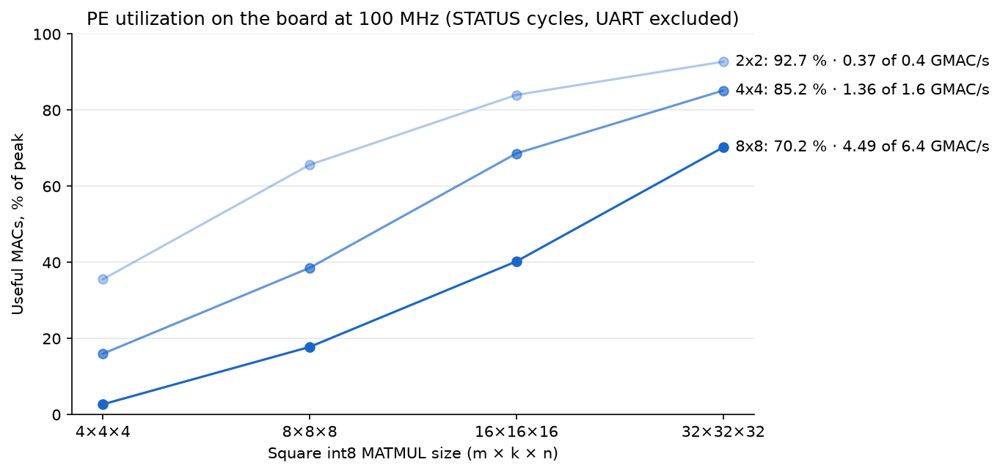
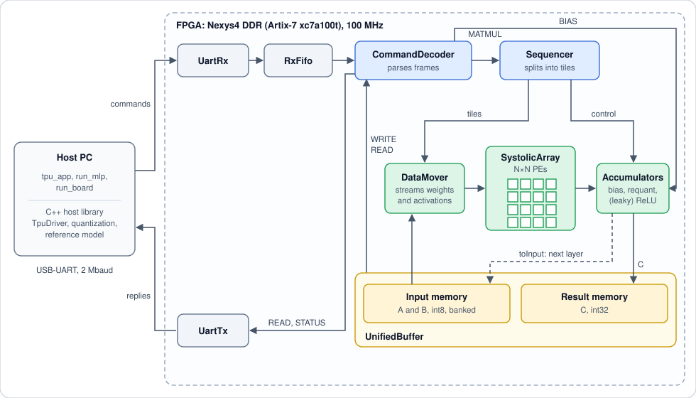

# Systolic-array neural-network accelerator

We built a small TPU-like accelerator for neural networks in Chisel, and it runs
on a Nexys4 DDR FPGA board. A PC sends it matrices over USB; our accelerator
multiplies them on a grid of multiply-accumulate units and sends the results
back.

At its heart is a systolic array: a grid of small processing elements, each
holding one weight, that pass values to their neighbours every clock cycle. We
load each weight once and reuse it for many inputs, and all the elements work
in parallel, so data mostly moves between neighbours instead of to and from
memory. That is what makes this kind of hardware fast and energy-efficient.

Our accelerator is general, not tied to one network. It computes matrix
products (int8 inputs, int32 sums) with bias, requantization and (leaky) ReLU,
and it can keep a layer's output on chip as the input of the next layer. To
change the network, you only load other weights: we synthesize one bitstream
once and it runs both of our models, handwritten digits and drawn shapes and
symbols. You can build larger networks from the same operations.



*`tpu_app`, our desktop app for the accelerator: pick a model, draw with the
mouse, and the network tells you what you drew, here a star. It runs on the TPU
on the board, or on its simulator as in this screenshot.*

More detail: [architecture](docs/architecture.md),
[running your own network](docs/extending.md).

## Quick start: the app

Download from the [releases](../../releases):

- the app: `tpu_app-windows-x64.zip` (unzip it and run `tpu_app.exe`) or
  `tpu_app-linux-x86_64.AppImage` (make it executable and run it);
- `bitstreams.zip`: our ready-made bitstreams for the three array sizes (2x2,
  4x4, 8x8). Unzip it next to the app (into the `tpu_app` folder on Windows,
  beside the AppImage on Linux) and the app finds them.

Then:

1. Without a board: start `tpu_app`, choose a model, keep **Run on: Simulator**
   and draw. The network runs on a bit-exact software model of our accelerator.
2. With the board: connect the Nexys4 DDR to your PC with the USB cable
   (PROG/UART port) and switch it on.
   - Load a bitstream with **Program FPGA...** in the app. You need Vivado on
     Windows or Linux for this; Vivado's Hardware Manager works too. The FPGA
     forgets the bitstream when you switch it off.
   - Select the board's serial port in **Run on** and the bitstream's size in
     **Array**, then draw.

## Build from source

Tools:

- JDK 17 or newer and sbt 1.13, for the hardware generator and its simulation
  tests (sbt downloads Scala 2.13 and Chisel 3.6.1).
- Vivado (we use 2026.1), to build bitstreams and program the FPGA.
- CMake 3.20 or newer and a C++20 compiler (we use MSYS2 MinGW g++ on Windows),
  for the host library, the command-line tools and their tests.
- Qt 6, optional (we use 6.8 and 6.12), for `tpu_app`.
- Python 3, optional, with numpy, scikit-learn and Pillow, to retrain the models.

### Test the hardware in simulation

Our tests simulate the Chisel design block by block, and as a whole system that
receives commands over its UART exactly like the board. CI runs the same tests
on every push. From the repository root:

```
sbt test
```

### Build a bitstream and load it

1. Generate the Verilog of one configuration (`2x2`, `4x4` or `8x8`); the
   generator writes it to `generated/8x8/`:

   ```
   sbt "runMain tpu.board.EmitBoard 8x8"
   ```

2. Synthesize, place and route it with Vivado. The script writes
   `build/8x8/BoardTop.bit`, the timing, resource and power reports, and
   `config.json`, which tells the host software how this build is configured
   (keep it with the bitstream):

   ```
   vivado -mode batch -source fpga/build.tcl -tclargs 8x8
   ```

3. Load it into the FPGA (or use **Program FPGA...** in the app). The FPGA
   forgets it when you switch the board off:

   ```
   vivado -mode batch -source fpga/program.tcl -tclargs 8x8
   ```

### Generate a bitstream for your own configuration

Two parameter classes set every size in our design: `SAConfig` (the array and
its memories) and `BoardConfig` (clock and serial link). `EmitBoard.configs`
([EmitBoard.scala](src/main/scala/tpu/board/EmitBoard.scala)) lists the
configurations you can build. To make a new one, add an entry, for example an
8x8 array with four times the input memory:

```scala
"8x8-16k" -> SAConfig(rows = 8, cols = 8, inDepth = 16384)
```

then build it with the steps above, using its name (`8x8-16k`). The generator
checks the combination and tells you what is wrong if it cannot build it.

| Parameter | Default | Meaning |
|---|---|---|
| `rows`, `cols` | 4, 4 | Array size. Square and a power of two for now |
| `inDepth` | 4096 | Input memory, int8 elements (A, B and chained layers); power of two, at most 65,536 |
| `outDepth` | 4096 | Result memory, int32 elements |
| `biasDepth` | 256 | Bias memory, int32 entries |
| `maxM` | 64 | Rows of A per MATMUL (depth of the accumulator memory) |
| `accWidth` | 32 | Accumulator width (inputs are 8-bit: the host protocol sends one byte per element) |
| `clockHz`, `baud` | 100 MHz, 2 Mbaud | `BoardConfig`: core clock and UART speed |

The other `SAConfig` fields (dataflow, weight loading, products per PE) only
accept what we implemented: weight-stationary, one weight row shifted in per
cycle, one product per PE per cycle.

### Build the host software and the app

On the host side we have a C++ library that talks to the board, `tpu_app`, and
the command-line tools we use for our measurements. From the repository root:

```
cd host/cpp
cmake -S . -B build -G "MinGW Makefiles"    # without -G on macOS and Linux
cmake --build build                          # builds tpu_app only if CMake finds Qt 6
./build/tpu_host_tests                       # the test suite; the board tests skip without a board
./build/tpu_app
```

Toolchain setup, the C++ API and board options: [host/README.md](host/README.md).

## Reproduce our measurements

We measured the performance and accuracy figures of this README on the board
with three command-line tools, which you build with the host software (in
`host/cpp/build/`):

- `run_board` benchmarks matrix products: it runs random int8 products from
  4×4×4 to 32×32×32, checks each against our reference model, and prints the
  cycles, the PE utilization and the multiply-adds per second.
- `run_mlp` runs a model's whole test set, checks every result bit for bit
  against the reference, and prints the accuracy and the cycles per layer.
- `tpu_host_tests` is our host test suite; its `Board` tests check products, a
  float product and two chained layers on the FPGA.

They talk to the board when you set `TPU_PORT` (its serial port) and
`TPU_CONFIG` (the bitstream's `config.json`), and to the software model
otherwise. From `host/cpp/`, for example:

```
TPU_PORT=COM3 TPU_CONFIG=../../build/8x8/config.json ./build/run_board
```

In PowerShell, set `$env:TPU_PORT` and `$env:TPU_CONFIG` first.

| What we measure | How | Where we recorded it |
|---|---|---|
| Throughput and PE utilization of matrix products (performance table and plot) | `./build/run_board` | `docs/data/run_board_<size>.txt`; plot: `python scripts/board_utilization.py` |
| Accuracy and cycles of a model | `./build/run_mlp demo/digits_model.json` (or `shapes_model.json`) | `docs/data/run_mlp_<size>.txt` |
| Correctness on the board | `./build/tpu_host_tests --gtest_filter=Board.*` | [board validation](docs/board-validation.md#on-board-tests) |
| Timing, resources, power | the Vivado reports that `fpga/build.tcl` writes in `build/<size>/` | [board validation](docs/board-validation.md#implementation) |
| Active cycles per PE (heatmap below) | `sbt "testOnly tpu.PeHeatmapSpec"`, then `python scripts/pe_heatmap.py` | `docs/figures/pe_heatmap.png` |
| The model files themselves | `python scripts/train_digits.py`, `python scripts/train_shapes.py` | `host/cpp/demo/*.json` |

## Running your own network

The app runs any model file with the same shape as ours, and you can drive any
sequence of matrix products from the C++ host library. How to add a model, what
our board supports today and where its limits are:
[docs/extending.md](docs/extending.md).

## Performance

We measured these numbers on the board at 100 MHz, for a 32×32×32 product. The
power figures are Vivado's estimates.

| Array | PEs (DSP) | LUTs | Cycles | GMAC/s (peak) | Of peak | Power | GMAC/s per W |
|---|---|---|---|---|---|---|---|
| 2x2 | 4 | 3,199 | 8,835 | 0.37 (0.4) | 92.7 % | 0.145 W | 2.6 |
| 4x4 | 16 | 3,883 | 2,405 | 1.36 (1.6) | 85.2 % | 0.178 W | 7.6 |
| 8x8 | 64 | 5,496 | 729 | 4.49 (6.4) | 70.2 % | 0.251 W | 17.9 |

Our design scales. The 8x8 array is 12× faster than the 2x2 for 1.7× the logic,
because each PE is one DSP slice and the logic around the array grows slowly.
It also does 7× more work per joule.



Bigger arrays need bigger products. Each tile costs a fixed fill and drain of
`rows + cols − 1` cycles, which the rows of A have to amortize. A small product
leaves a large array mostly idle: 4×4×4 keeps only 2.7 % of the 8x8 busy and
runs slower there than on the 4x4. From 8×8×8 upwards the 8x8 always wins.

Padding costs cycles. We pad k and n to a multiple of the array size, so one
ragged product (16×6×5) on the 4x4 uses only 480 of its 1,024 PE-cycles:


On a real network the link dominates. Our 8x8 array classifies the 450 test
digits in 12,606 cycles (0.13 ms, 0.28 µs per image), the 2x2 in 1.5 ms. Sending
the images and reading the results over the 2 Mbaud UART takes about 0.3 s (we
estimated this from the bytes sent). That is why we keep chained layers on chip
and send images in batches.

| Model | Accuracy |
|---|---|
| Handwritten digits (64-16-10), on the board, 2x2, 4x4 and 8x8 | 434 / 450 = 96.4 %, bit-exact with the integer simulation (float model: 96.7 %) |
| Shapes and symbols (64-16-10), on the software model | 300 / 300 stored test drawings (99.9 % of 3,000 generated ones) |

All configurations, timing and per-layer numbers:
[board validation](docs/board-validation.md).

## Architecture



- Host PC: `tpu_app` or the command-line tools, on top of our C++ library. It
  quantizes the data, sends commands over the USB-UART link at 2 Mbaud and
  checks the results against a bit-exact reference model.
- `UartRx`: receives the bytes from the serial line.
- `RxFifo`: holds up to 16 bytes while the decoder is busy.
- `CommandDecoder`: parses each frame. It writes matrices into the input memory,
  biases into the accumulators, hands MATMULs to the sequencer and answers READ
  and STATUS.
- `Sequencer`: cuts a MATMUL into array-sized tiles and issues them back to back.
  It also counts the cycles and busy PE-cycles that STATUS reports.
- `DataMover`: streams each tile's weights and activations from the input memory
  into the array.
- `SystolicArray`: the N×N grid of processing elements; each one does an int8
  multiply-add per cycle on one DSP slice.
- `Accumulators`: add up the partial sums across tiles, add the bias, requantize
  to int8 and apply (leaky) ReLU.
- `UnifiedBuffer`: the input memory (A and B, int8, one bank per array column)
  and the result memory (C, int32). With `toInput`, the accumulators write C back
  into the input memory, so the next layer reads it without a trip to the host.
- `UartTx`: sends READ data and STATUS replies back to the host.

How data flows through the array, how we tile large products, our memories and
the host protocol: [docs/architecture.md](docs/architecture.md).

## Verification

We check our design at several levels, from single blocks to the board:

- Unit tests: every block (UART, decoder, buffer, sequencer, data mover, array,
  accumulators) has its own simulation tests in chiseltest
  (`src/test/scala/tpu/`).
- Full system: `TpuSpec` simulates the whole core and drives it through its UART
  byte by byte, exactly like the real host (`src/test/scala/tpu/TpuSpec.scala`);
  `TpuSpec` covers the 4x4 in depth and `TpuConfigsSpec` runs a tiled product
  on the other buildable sizes.
- Reference models: we wrote a bit-exact model of what one MATMUL computes, in
  Scala (`tpu.ref.RefModel`) and in C++ (`host/cpp/src/reference.cpp`). Both
  check the same shared vectors (`src/test/resources/ref_vectors.txt`), so they
  cannot drift apart.
- Host tests: 112 tests check the protocol, the driver, quantization and both
  models against `FakeTpu`, a software TPU that answers the same protocol
  (`host/cpp/tests/`).
- Board tests: products of many shapes, a float product, two chained layers and
  the digits model run on the FPGA and must match the reference bit for bit, on
  2x2, 4x4 and 8x8 ([board validation](docs/board-validation.md)).
- Continuous integration: GitHub Actions runs `sbt test` on every push, and
  builds and tests the host on Windows and Linux for every pull request that
  touches it.

## Limitations

The clearest limitation is the link to the PC. Our UART runs at 2 Mbaud, about
200 KB/s, and the host sends every command and polls for every result. On the
digits model the array computes for 0.13 ms while the data takes about 0.3 s to
travel. Keeping layers on chip (`toInput`) and batching hide part of it, but any
network bigger than ours would spend nearly all its time on the link.

Compared with a commercial TPU, such as Google's first TPU
([Jouppi et al., 2017](https://arxiv.org/abs/1704.04760)):

| | Our accelerator (8x8) | Google TPU v1 |
|---|---|---|
| Multiply-accumulate units | 64, at 100 MHz | 65,536 (256×256), at 700 MHz |
| Peak throughput | 6.4 GMAC/s | 92 TOPS (int8) |
| On-chip memory | 4 KiB input, 16 KiB result | 24 MiB unified buffer, 4 MiB accumulators |
| Off-chip memory | none | 8 GiB DDR3 for the weights |
| Link to the host | UART, about 200 KB/s | PCIe Gen3 x16 |
| Control | one command at a time from the host | instructions queued on chip, run back to back |
| Activations | ReLU, Leaky ReLU | ReLU, sigmoid, tanh, plus pooling |

Our design also only supports int8 inference, square power-of-two arrays and
one requantization scale per layer. [docs/extending.md](docs/extending.md) lists
every limit and which ones a parameter change can lift.

## Repository layout

| Path | Content |
|---|---|
| `src/main/scala/` | Chisel sources: `ifaces/` (`SAConfig`, interfaces), `tpu/` (core, `board/`, `io/`, `compute/`, `memory/`) |
| `src/test/` | Scala tests, the reference model `tpu.ref.RefModel` and shared `ref_vectors.txt` |
| `host/` | C++ host library, `tpu_app`, tools and tests ([host/README.md](host/README.md)) |
| `fpga/` | Vivado scripts, pin constraints, timing notes |
| `scripts/` | Python: model training, performance plot, PE heatmap |
| `docs/` | [Architecture](docs/architecture.md), [running your own network](docs/extending.md), [board validation](docs/board-validation.md), [design decisions](docs/design-decisions.md), [making a release](docs/releasing.md) |

## Use of AI tools

We used AI assistants (LLMs) in three ways:

- To improve the wording of our documentation.
- For early prototyping, to get a quick first draft of an idea, such as the
  first version of the host application for our MVP.
- To assist with coding and to teach us Chisel and C++. A team member checked
  every result: we reviewed the code, and our tests, the reference models and
  the board runs had to agree before anything was merged.
