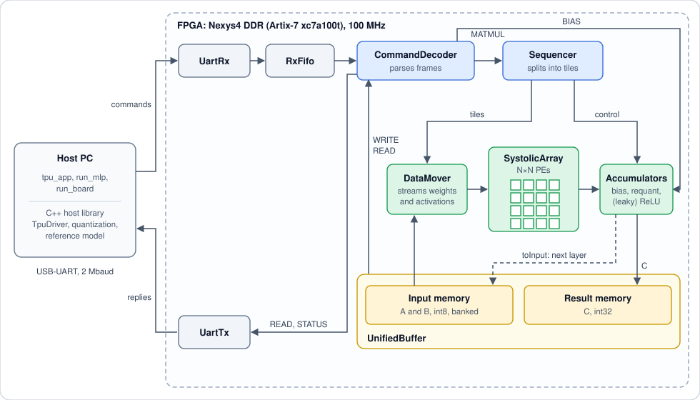
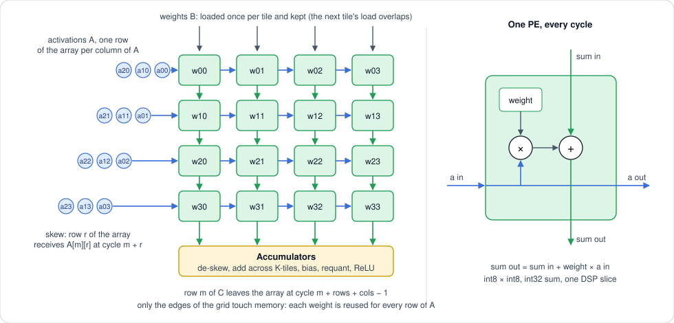

# Architecture

How the accelerator is built: the blocks, how data moves through the systolic
array, how a large product is cut into tiles, and the commands the host sends.
For the overview see the [README](../README.md).

## System



The host sends commands over the USB-UART link. The `CommandDecoder` writes
matrices into the `UnifiedBuffer`, loads biases into the Accumulators, and
hands each MATMUL to the `Sequencer`. The Sequencer cuts the product into
array-sized tiles. For each tile the `DataMover` streams weights and
activations from the buffer into the `SystolicArray`, and the `Accumulators`
sum the partial results, post-process them and write C back into the buffer.
The host reads C with READ, or leaves it on chip as the next layer's input
(`toInput`).

| Block | Source | Role |
|---|---|---|
| `UartRx`, `RxFifo`, `UartTx` | `tpu/io/` | Serial line (8N1, 2 Mbaud) with a 16-byte receive FIFO |
| `CommandDecoder` | `tpu/io/CommandDecoder.scala` | Parses frames: buffer writes and reads, bias writes, MATMUL instructions, STATUS replies; checks frames and sets the error flag |
| `Sequencer` | `tpu/compute/control/` | Splits a MATMUL into tiles and issues them back to back; counts cycles and busy PE-cycles |
| `DataMover` | `tpu/compute/datapath/` | Reads weight and activation rows from the banked buffer and feeds the array |
| `SystolicArray` | `tpu/compute/array/` | The N×N grid of processing elements, with input skew and output de-skew |
| `Accumulators` | `tpu/compute/datapath/` | Sum partial results across K-tiles, add the bias, requantize, (leaky) ReLU |
| `UnifiedBuffer` | `tpu/memory/` | Input memory (A and B, int8, one bank per array column) and result memory (C, int32) |

`Tpu` (`tpu/Tpu.scala`) is the core plus the UART; `BoardTop` adds clock
generation and pins for the FPGA. Every size and width comes from two
parameter classes, `SAConfig` (the array and its memories) and `BoardConfig`
(clock, baud rate); the README lists them.

## Dataflow in the array



The array is **weight-stationary**: each processing element (PE) holds one
weight of B. For C = A · B with an array of R rows and C columns:

- A tile of B (R × C weights) is shifted into the PEs and stays there.
- The rows of A stream in from the left. Column r of A enters array row r,
  delayed by r cycles (the skew), so that values meet the right partial sums.
- Every cycle each PE multiplies its activation by its weight, adds the partial
  sum from above, passes the sum down and the activation right.
- Sums leave the bottom row and are realigned (de-skew) before the
  Accumulators.

Timing, with one register per PE hop:

| Event | Cycle |
|---|---|
| A[m][r] enters array row r | m + r |
| Row m of the tile's output leaves the array | m + R + C − 1 |
| One tile with M rows of A | about M + R + C − 1, the weight load overlapping the previous tile |

**Why it is efficient.** Only the edges of the grid touch memory. A weight is
loaded once per tile and used for every row of A; an activation is read once
and used by all C PEs of its row. Each PE is one int8 × int8 multiply-add per
cycle, one DSP slice on the FPGA.

**Weight double buffering.** Each PE has a second weight register. The next
tile's weights shift in while the current tile computes, and the PE switches on
the first activation of the new tile, so tiles run back to back.

## Tiling

One pass of the array sums R values of k. Larger products are cut into tiles
by the Sequencer:

```
for each column tile nt of C (n / cols):
    for each K-tile kt (k / rows):
        load the weights B[kt, nt]        overlapped with the previous tile
        stream the m rows of A[:, kt]     partial sums out of the array
        accumulate: first kt writes, later ones add
    last kt: bias, requantize, ReLU, write C[:, nt]
```

k and n are padded with zeros to a multiple of the bank count; m needs no
padding but is limited to `maxM` (64) per MATMUL, the depth of the accumulator
memory. The host splits a taller A into several MATMULs. Padding costs PE
cycles when a matrix does not match the array: see the
[PE heatmap](design-decisions.md#87-pe-heatmap-52--pr-57).

## Post-processing

Each output element goes through the same steps, all optional except the sum:

1. **Sum**: `acc = bias[col] + Σ a·w`, int32, wrapping like the hardware
   accumulator. The bias is added on the first K-tile (the accumulator starts
   from it), so it costs no extra pipeline stage.
2. **Requantize**: `(acc + 2^(shift−1)) >> shift` (round half up), then
   saturate to [−127, 127].
3. **ReLU**: negative values become 0, or `x >> leakShift` (Leaky ReLU with
   slope 2^−leakShift).
4. **Write**: to the result memory as int32, or with `toInput` to the input
   memory as int8, ready to be the A of the next MATMUL.

The same steps are modelled bit-exactly by `tpu.ref.RefModel` (Scala) and
`host/cpp/src/reference.cpp` (C++). Both are checked against the shared vectors
in `src/test/resources/ref_vectors.txt`.

## Memories

| Memory | Default size | Element | Parameter |
|---|---|---|---|
| Input memory (A, B, chained layers) | 4096 | int8 | `inDepth` |
| Result memory (C) | 4096 | int32 | `outDepth` |
| Bias memory | 256 | int32 | `biasDepth` |
| Accumulator memory (rows of C per MATMUL) | 64 | int32 × cols | `maxM` |

All four are block RAMs on the FPGA. For the bitstreams the input and
accumulator memories are Xilinx XPM macros (`SAConfig.xpmMemories`, set by
`EmitBoard`); the simulations use `SyncReadMem`.

The input memory has one bank per array column, so the DataMover reads a whole
row per cycle. Addresses and leading dimensions of A and B must therefore be
multiples of the bank count, and addresses are 2 bytes in the protocol, which
caps the input memory at 65,536 elements.

## Host protocol

Every frame starts with an opcode byte; multi-byte fields are little-endian.
The exact layout is documented in
[`HostProtocol.scala`](../src/main/scala/tpu/io/HostProtocol.scala).

| Command | Opcode | Payload | Reply |
|---|---|---|---|
| WRITE | 0x01 | addr, count, count int8 values | none |
| READ | 0x02 | addr, count, size (1 or 4 bytes) | count × size bytes |
| MATMUL | 0x03 | addresses of A, B, C; m, k, n; ldA, ldB, ldC; flags (requant, ReLU, toInput, bias, leakShift); shift; biasAddr | none |
| STATUS | 0x04 | none | 9 bytes: busy, error and overrun flags, cycles and busy PE-cycles of the last MATMUL |
| BIAS | 0x05 | addr, count, count int32 values | none |

A MATMUL runs in the background: the host polls STATUS until busy is 0. An
invalid frame sets the sticky error flag, which STATUS reports and clears.

## Verification

| Level | What | Where |
|---|---|---|
| Unit | Each block in simulation (chiseltest) | `src/test/scala/tpu/` |
| Full system | `TpuSpec` drives the UART like the real host | `src/test/scala/tpu/TpuSpec.scala` |
| Reference | Bit-exact Scala and C++ models, shared vectors | `tpu.ref.RefModel`, `host/cpp/src/reference.cpp` |
| Host | Protocol, driver and models against a software TPU (`FakeTpu`) | `host/cpp/tests/` |
| Board | Products, float product, chained layers, MLPs on the FPGA | `host/cpp/tests/test_board.cpp`, [board validation](board-validation.md) |
