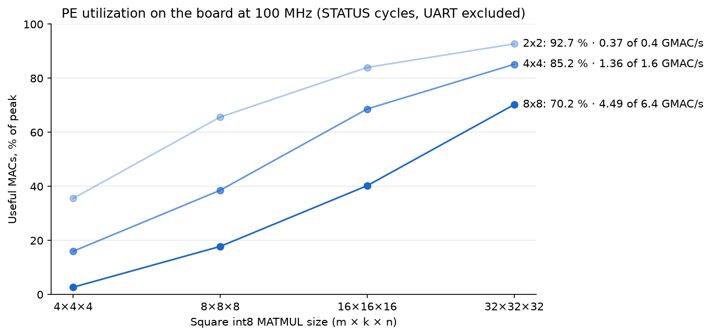

# Board validation (2x2, 4x4, 8x8)

Run on 2026-11-28 on a Nexys4 DDR. All three array configurations build at
100 MHz with timing met, pass every on-board test bit-exact against the
reference model, and run the digits MLP at 96.4 % and the shapes MLP at 100 %
accuracy.

## Setup

| Item | Value |
|---|---|
| Board / part | Nexys4 DDR, xc7a100tcsg324-1 |
| Tools | Vivado 2026.1, non-project flow (`fpga/build.tcl`) |
| Core clock / UART | 100 MHz / 2 Mbaud |

## Implementation

All user timing constraints are met. DRC reports only DSP-pipelining and
RAMB18 warnings, no errors.

| Config | WNS (ns) | WHS (ns) | LUT | FF | BRAM (36 Kb) | DSP | Power (W) |
|---|---|---|---|---|---|---|---|
| 2x2 | 0.315 | 0.046 | 1,220 (1.9 %) | 1,373 (1.1 %) | 7 | 4 | 0.118 |
| 4x4 | 0.442 | 0.041 | 1,880 (3.0 %) | 2,029 (1.6 %) | 10 | 16 | 0.150 |
| 8x8 | 0.360 | 0.037 | 3,326 (5.2 %) | 3,879 (3.1 %) | 16 | 64 | 0.235 |

One DSP per PE in every configuration: the multipliers map to DSP48 slices,
not LUTs. The report excerpts are in [docs/data/](data/) (`vivado_<config>/`).

## On-board tests

Each bitstream was loaded with `fpga/program.tcl` and checked with
`tpu_host_tests --gtest_filter=Board.*`. All 4 tests pass on all 3
configurations (12/12).

| Test | What it checks | 2x2 | 4x4 | 8x8 |
|---|---|---|---|---|
| StatusAnswers | STATUS reply; busy, error and overrun flags clear | Pass | Pass | Pass |
| ProductsMatchTheReferenceModel | 10 int8 products bit-exact: K/N tiling, padding, m = max_m, m > max_m split, requant, ReLU, extreme values, 32x32x32 | Pass | Pass | Pass |
| FloatProductIsClose | 16x24 · 24x8 float product via quantization, max error < 5 % of peak | Pass | Pass | Pass |
| TwoLayerChainMatchesReference | 8 → 16 → 8 layers chained on chip (`toInput`), bit-exact | Pass | Pass | Pass |

## MATMUL throughput

`run_board` runs random int8 square products on each bitstream; every result
matched the reference model. Cycles are the accelerator's STATUS counter. The
raw outputs are in [docs/data/](data/) (`run_board_<config>.txt`).

The figure is drawn from those files by `scripts/board_utilization.py`
(`python scripts/board_utilization.py` from the repository root).

| Size (m = k = n) | 2x2 cycles | 2x2 GMAC/s | 4x4 cycles | 4x4 GMAC/s | 8x8 cycles | 8x8 GMAC/s |
|---|---|---|---|---|---|---|
| 4 | 45 | 0.14 | 25 | 0.26 | 37 | 0.17 |
| 8 | 195 | 0.26 | 83 | 0.62 | 45 | 1.14 |
| 16 | 1,219 | 0.34 | 373 | 1.10 | 159 | 2.58 |
| 32 | 8,835 | 0.37 | 2,405 | 1.36 | 729 | 4.49 |
| **Peak** | | 0.4 | | 1.6 | | 6.4 |

Small products leave most of a large array idle: 4x4x4 on 8x8 uses 2.7 % of
its peak and is slower than on 4x4. From 8x8x8 upwards the larger array is
always faster.

## Digits MLP demo

`run_mlp` classifies 450 test images with a 64 → 16 → 10 MLP in batches of 32.
Layer 1 (bias + requant + leaky ReLU) writes its output back into the input
memory, so the hidden layer never leaves the chip; layer 2 (bias) returns
int32 logits. Every batch matched the C++ reference and the Python integer
simulation bit for bit.

| Config | Accuracy | Layer 1 cycles | Layer 1 util. | Layer 2 cycles | Layer 2 util. |
|---|---|---|---|---|---|
| 2x2 | 434/450 (96.4 %) | 120,549 | 95.6 % | 33,573 | 85.8 % |
| 4x4 | 434/450 (96.4 %) | 31,935 | 90.2 % | 9,903 | 72.7 % |
| 8x8 | 434/450 (96.4 %) | 9,129 | 78.9 % | 3,477 | 51.8 % |

Cycles are summed over the 15 batches. From 2x2 to 8x8, layer 1 gets 13.2x
faster with 16x more PEs. The raw outputs are in [docs/data/](data/)
(`run_mlp_<config>.txt`; "on the board" in the first line means it ran on the
FPGA, not on FakeTpu).

## Shapes MLP demo

`run_mlp demo/shapes_model.json` classifies the model's 300
stored test drawings (10 shapes and symbols) with the same 64 → 16 → 10
layout and the same on-chip chaining as the digits model. Every batch matched
the reference bit for bit.

| Config | Accuracy | Layer 1 cycles | Layer 1 util. | Layer 2 cycles | Layer 2 util. |
|---|---|---|---|---|---|
| 2x2 | 300/300 (100 %) | 79,870 | 96.2 % | 22,270 | 86.2 % |
| 4x4 | 300/300 (100 %) | 20,958 | 91.6 % | 6,534 | 73.5 % |
| 8x8 | 300/300 (100 %) | 6,044 | 79.4 % | 2,312 | 51.9 % |

The raw outputs are in [docs/data/](data/) (`run_mlp_shapes_<config>.txt`).