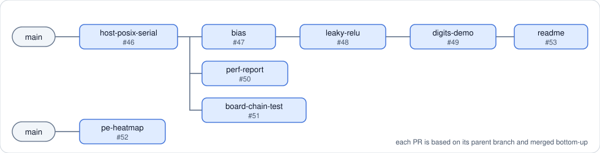
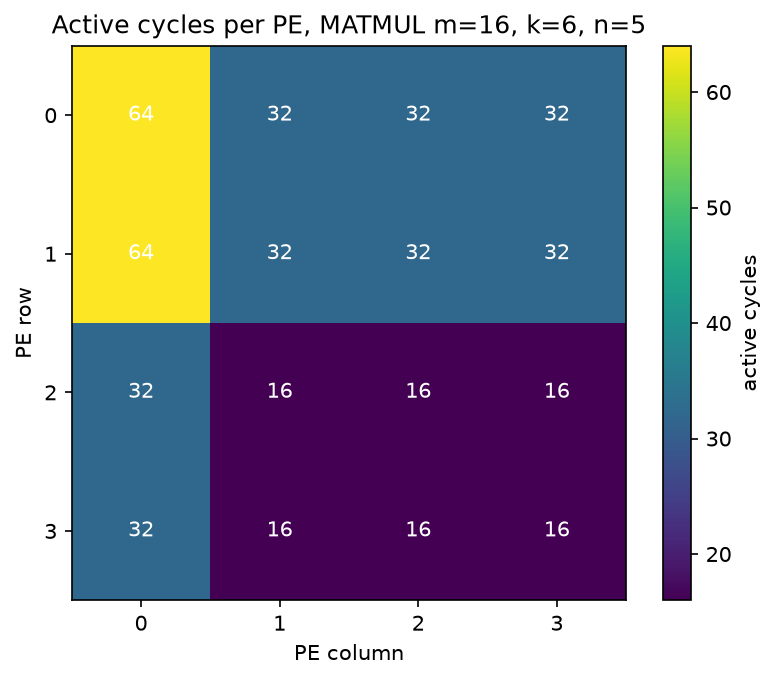

# Final-version features: design decisions

What we added for the final version, the order we did it in, why each design
looks the way it does, and the questions we answered along the way. It is meant
to be read on its own (e.g. when preparing the presentation).

- Tracking: GitHub issues #46–#53 on the project board "Systolic Arrays Board".
- One pull request per feature; dependent PRs are stacked on their parent branch.

---

## 1. Starting point

The candidate feature list for the final version came from two sources: the
team's `TODO.md` and a list of suggested extensions:

| Suggested extension | What it asked for |
|---|---|
| Small neural network integration | A two-layer MLP using the accelerator for its matrix products |
| Bias support | Bias vectors added after accumulation, for realistic layers |
| More activation functions | Leaky ReLU, ReLU6, HardTanh |
| Systolic-array visualization | Heatmap or animation of values moving through the PEs |
| Performance dashboard | Cycle count, PE utilization, throughput |

Before planning we checked what the code already does, because several items
turned out to be partly done:

| Item | State found in the code |
|---|---|
| 2-layer MLP | Already runs as a simulation test (`TpuSpec`: `requant(relu(X·W1))·W2`, 8→12→4) using on-chip layer chaining. Missing: a real trained model and a demo on the host. |
| Performance numbers | The hardware already returns `cycles` and `busyPeCycles` (= m·k·n) in the STATUS reply, and the C++ host already has `Perf::utilization()`. The host's `run_board.cpp` was an empty `main()`. |
| Weight double buffering, layer chaining | Done (PR #44, PR #43). |
| Activations | ReLU and requantization exist. No other activation. |
| Bias | Not present. |
| Integration tests | `TpuSpec` is already a full-system simulation (it drives the UART like the real host). `host/cpp/tests/test_board.cpp` already checks products against the reference model on the real board. Gap: no board test for layer chaining. |
| README | No root README. |
| Host portability | The C++ host only builds on Windows (`serial_link.cpp` includes `<windows.h>` unconditionally). |

## 2. Priority order and why

| # | Feature | Why at this position |
|---|---|---|
| 1 | Bias support | Without bias no realistic layer can run, so the demo depends on it. |
| 2 | Neural-network demo | The payoff of the whole project: a trained model running end to end. Merges three TODO items ("integrate a small NN", "add a real NN model", "simple demo"). |
| 3 | Performance report | Very cheap (the counters exist) and it gives before/after evidence for the double-buffering work. |
| 4 | README | Needed anyway; the place where the numbers from 3 end up. |
| 5 | Extra activation | Cheap, but only worth adding if it is meaningful in int8 (see 4.2). |
| 6 | Integration test | Mostly exists already; the missing piece is a board test for layer chaining. |
| + | PE heatmap | One static figure for the report instead of an animation. |

A prerequisite was added in front of all of them: **making the C++ host build
on macOS/Linux**, because otherwise none of the host-side work can be compiled
or tested on the development machine (see 4.3).

## 3. What we deliberately excluded

| Excluded | Reason |
|---|---|
| Animated systolic-array visualization | The most expensive item (per-PE tracing plus a UI) and it adds no capability to the accelerator. Replaced by: *"If you want a figure for the report, take one heatmap from a ChiselSim waveform dump instead of building an animation."* (Our tests use chiseltest 0.6.2, so the dump is a chiseltest VCD.) |
| Formal verification | Large effort for this project; correctness is already covered by a bit-exact reference model (Scala and C++), shared reference vectors and full-system simulation. |
| "Improve the UI" | Too vague to plan; the performance printout covers what matters. |
| Ethernet-compatible pipelining | No Ethernet link exists yet; designing an interface for it now would be speculative. |
| ReLU6 and HardTanh | Their clamp value depends on the output scale in fixed point (see 4.2). |

---

## 4. Questions we answered, with context

Each question below lists the options that were considered, the choice, and the
reasoning behind it.

### 4.1 How should bias be implemented?

**Context.** The accelerator had no bias. A MATMUL frame had no spare field for
a bias address. Biases have to be int32: they live at the accumulator's scale
(`s_x · s_w`), not at int8 scale.

| Option | Description | Cost |
|---|---|---|
| Host-only trick | Append a constant column to A and the bias as an extra row of B (k + 1). No RTL change; bias resolution about one output LSB; chained layers need an extra neuron that outputs a constant. | Very small |
| **Hardware bias (chosen)** | A real "add bias after accumulation" stage in the Accumulators, as the suggestion describes. | About 5–10× more code: RTL, protocol, both reference models, FakeTpu, driver |

**Why hardware.** It matches the feature as specified ("add bias vectors after
accumulation"), gives full int32 precision, and keeps the layer description
clean (no padded "constant" neurons).

### 4.2 Which protocol change for the bias?

| Option | Description |
|---|---|
| **New BIAS opcode + MATMUL field (chosen)** | Opcode `0x05 BIAS(addr, count, count × int32)` writes a small bias memory inside the Accumulators. MATMUL gets a *bias* flag bit and a 2-byte `biasAddr` (frame grows from 21 to 23 bytes), so each layer picks its own biases. |
| BIAS opcode only, frame unchanged | The bias memory holds one layer at a time from address 0; the host has to wait for every MATMUL and rewrite the biases before the next layer. Less RTL, but chained layers are serialised by the host. |

**Why.** With a bias address per MATMUL, both layers' biases are loaded once
and the two chained MATMULs run back to back, which is the point of on-chip
layer chaining.

**Where the bias is added.** The result is `y = post(acc + bias[col])`, where
`post` is the existing requantize / ReLU path, so the bias also applies when
requantization is off. Two places in the Accumulators could do the addition:

| Option | Trade-off |
|---|---|
| At write-back, before rounding | Simple to reason about, but puts an extra 32-bit adder right after the BRAM output, the path that was tuned to reach 100 MHz. |
| **On the first K-tile (chosen)** | The accumulator starts from the bias instead of from zero: `acc = bias + Σ partial sums`. The first tile already writes a fresh value (no add), so adding the bias there costs no extra stage on the critical path. The write-back pipeline is untouched. |

The bias row is captured together with the first tile's data at the
pipeline's first stage, because the control for the next tile can already be
latched while the previous tile's rows are still in the pipeline.

**No race with a running MATMUL.** The command decoder accepts new frames while
a MATMUL runs, so a BIAS frame could overwrite biases in use. The decoder
therefore holds a BIAS frame until the accelerator is idle (one extra
condition), instead of relying on the host to wait.

**Compatibility.** The shared reference vectors contain 8 old 21-byte MATMUL
frames. They are extended with `biasAddr = 0` (bias off), which keeps their
meaning; both the Scala and C++ vector tests keep checking them.

### 4.3 Which extra activation function?

**Context.** The datapath is integer: an int8 output value `q` means the real
number `q · scale`.

- **ReLU6** clamps at 6 *in real units*, i.e. at `round(6 / scale)` in integer
  units. That value depends on each layer's scale, so the host must send it:
  this needs a new frame field.
- **HardTanh** clamps to [−1, 1]: same problem, and with typical scales the
  range [−1, 1] is only a few integer steps, so it is nearly meaningless.
- **Leaky ReLU** with a power-of-two slope (negative values `>> s`) does not
  depend on scale at all: shifting is the same operation at any scale.

| Option | Choice |
|---|---|
| **Leaky ReLU, slope shift in unused MATMUL flag bits** | **Chosen** |
| Leaky ReLU + ReLU6 with a host-computed clamp byte | Rejected: frame change for little benefit |
| None | Rejected |

**Design.** MATMUL flag bits carry `leakShift` (0–7). With ReLU on, negative
values become `x >> leakShift`; `leakShift = 0` is today's plain ReLU, so old
frames keep their meaning.

> Note: the first priority list recommended ReLU6. Checking the int8
> arithmetic showed it has the same scale problem used to reject HardTanh, so
> the recommendation was corrected to Leaky ReLU.

### 4.4 How should the C++ host be built and tested off Windows?

**Context.** The host's serial port code is Windows-only, and development
happens on macOS.

| Option | Description |
|---|---|
| Guard + stub | `#ifdef _WIN32` around the Windows code; elsewhere opening a port throws. Library and FakeTpu tests build everywhere; board runs stay Windows-only. |
| **POSIX serial port (chosen)** | Also implement the serial port with `termios`, so the board can be driven from macOS/Linux too. About 60 more lines. |
| Don't touch it | Leave host verification to a Windows teammate. |

**Why.** Every later host feature (bias, Leaky ReLU, demo, performance report)
must be compiled and tested; with a POSIX port it can also be run on the board
from any machine. Detail: 2 Mbaud is not a standard `termios` speed on macOS,
so it is set with the `IOSSIOSPEED` ioctl.

### 4.5 Which neural network and dataset for the demo?

| Option | Description |
|---|---|
| Iris, pure Python | 4→8→3 MLP, 150 samples, no numpy needed. Tiny and safe. |
| **Digits 8×8, numpy + scikit-learn (chosen)** | 64→16→10 MLP on handwritten digits. More convincing in a demo. Needs a Python venv. |

**Why.** Recognising handwritten digits is a more compelling demonstration.

**Fitting it in the hardware (4×4 array, 4096-byte input memory, m ≤ 64).**
Images are processed in batches of 32:

| Buffer | Size (int8 elements) |
|---|---|
| X: 32 images × 64 pixels | 2048 |
| W1: 64 × 16 | 1024 |
| Hidden H: 32 × 16 (written back on chip) | 512 |
| W2: 16 × 16 (10 outputs padded to 16, a multiple of banks for 2×2, 4×4 and 8×8) | 256 |
| **Total** | **3840 ≤ 4096** |

**Flow.** Training and quantization happen offline in Python
(`scripts/train_digits.py`), which exports the int8 weights, int32 biases,
requantization shifts and a test set to JSON. The C++ demo (`run_mlp`) loads
the JSON and runs both layers on the board (or on the software FakeTpu when
no board is attached): layer 1 uses bias + requant + ReLU and writes its output
back into the input memory (layer chaining), and layer 2 uses bias and returns
raw int32 logits. Every batch is checked bit-exact against the C++ reference
model, and the demo prints accuracy and per-layer cycles, utilization and
throughput.

### 4.6 What should the PE heatmap show?

| Option | Description |
|---|---|
| **Per-PE active cycles (chosen)** | One rows×cols grid: how many cycles each PE did a useful multiply during one MATMUL. Shows the skewed wavefront and the fill/drain idle time. |
| Snapshots over time | A strip of grids, one per cycle, showing the wavefront moving. |

**Method.** A chiseltest run of one MATMUL on the whole core dumps a VCD
waveform; a Python script turns it into a PNG.

- *What counts as "active".* The PE has no "useful multiply" signal, and in
  gap cycles junk values flow through the array, so "activation ≠ 0" would be
  wrong. A PE (i, j) counts as active at cycle t when the array's input-valid
  signal was high at cycle t − i − j (the skew delay to reach that PE) and its
  active weight is non-zero.
- *Choice of shape.* With square, fully used tiles every PE does the same work
  and the heatmap would be flat. A ragged product (e.g. k = 6, n = 5 on a 4×4
  array, padded to 8) leaves some PE rows and columns idle in some tiles. That
  shows the real cost of padding, which is the interesting part of the figure.

### 4.7 How should the pull requests be organised?

Bias, Leaky ReLU and the demo all touch the same files (Accumulators, protocol,
both reference models).

| Option | Description |
|---|---|
| **Stacked PRs (chosen)** | Each dependent PR is based on its parent branch, so all PRs can be opened at once and merged bottom-up. |
| Sequential on main | Every PR is based on main; the next one is opened only after the previous one is merged. |

### 4.8 Commits

The PRs are committed and pushed with the team member's own git identity. Each
change is a separate branch and PR referencing its issue.

### 4.9 How should the input and accumulator memories reach block RAM?

Vivado inferred both as LUT RAM: Chisel 3.6 emits each input bank's
read-write port as a separate write and read port (three ports in all), and
Vivado rejects `ram_style = "block"` on the accumulator memory. The bitstreams
therefore use Xilinx XPM macros for them (`xpm_memory_tdpram`,
`xpm_memory_sdpram`), selected by `SAConfig.xpmMemories`, which `EmitBoard`
sets. The simulations keep `SyncReadMem`, so the design stays testable in
chiseltest; the XPM version is checked on the board.

---

## 5. Engineering rules followed

- **Smallest complete change.** No new abstractions, options or speculative
  code; follow the existing structure and naming.
- **Bit-exact models.** Every RTL behaviour change updates the Scala reference
  model (`tpu.ref.RefModel`) and the C++ reference model and FakeTpu together,
  and is covered by tests on both sides.
- **Backward compatible.** New features default off, so existing frames and
  the shared reference vectors keep their meaning.
- **Verified before review.** `sbt test` and the C++ test suite pass before
  each PR; CI runs `sbt test` on every push.

## 6. Plan review

Before implementation, the plan was checked against the code by an
independent reviewer. Its main corrections, all adopted:

| Finding | Effect on the design |
|---|---|
| Bias at write-back adds an adder on the 100 MHz critical path | Bias moved to the first K-tile (4.2) |
| Decoder accepts frames during a MATMUL | BIAS frames are held until idle (4.2) |
| Old 21-byte frames in the shared reference vectors | Extended with `biasAddr = 0` |
| Uniform data gives a flat heatmap; "activation ≠ 0" counts junk | Ragged shape and valid-based activity (4.6) |
| 64×64×64 does not fit the 4096-byte input memory | Performance sweep uses 4, 8, 16, 32 |
| Host default clock was 50 MHz, the board runs at 100 MHz | Default corrected, so MAC/s is not off by 2× |
| FakeTpu reports a cycle *formula* (no tile overlap) | Numbers from FakeTpu are labelled "model", not hardware |
| A FakeTpu chaining test already exists | The integration test only adds the board variant |

## 7. Limits

- No Nexys4 DDR board or Vivado on the development machine: board tests
  compile and skip, and the timing/resource cost of the bias memory is
  unchecked until the next Vivado build. (Checked since: Vivado builds the
  bias memory in block RAM and every configuration meets timing, see
  [board validation](board-validation.md).)

---

## 8. Per-feature implementation notes

Filled in as each PR is completed: what changed, where, and anything that
turned out differently from the plan.

### 8.1 Host on macOS/Linux (#46) — PR #54
- `serial_link.cpp`: the Windows code is kept under `#ifdef _WIN32`; a new
  POSIX (termios) implementation sits behind the same API (raw 8N1, no flow
  control, 100 ms read timeout, partial-write handling, flush on open).
- 2 Mbaud: the `IOSSIOSPEED` ioctl on macOS, where the rate is non-standard;
  `B2000000` on Linux.
- Simplification: on Linux only the two rates the project uses (115200 and
  2 Mbaud) are accepted, marked as a `shortcut:` in the code.
- Verified on macOS: 84 host tests pass and the board tests skip. The Linux
  branch is not compiled here and there was no real-board run.

### 8.2 Bias (#47) — PR #58
**Protocol**
- New `BIAS` command (`0x05`): `addr, count`, then `count` int32 values
  (little-endian), written into the bias memory.
- MATMUL flag bit 3 = bias; bytes 21–22 = `biasAddr`. The frame grows from 21
  to 23 bytes.

**Hardware**
- `SAConfig.biasDepth = 256` int32 entries: one bank per PE column,
  asynchronous read. Planned as LUT RAM; Vivado moves the register that takes
  the read into a block RAM, one RAMB18 per column.
- The sequencer gives each output tile `biasAddr + nOff`, so every N-tile picks
  up its own columns' biases.
- In the Accumulators, the bias row is read at the pipeline's first stage, from
  the control values latched for the row's own tile (the next tile's control
  may already be arriving). Stage 1 writes `partial sum + bias` on the first
  K-tile instead of the bare partial sum.
- The write-back, rounding and requantization paths are untouched, so the
  critical path after the BRAM is unchanged.

**Decoder**
- A BIAS frame received while a MATMUL runs stops after its header and
  consumes nothing more until the accelerator is idle. Its data bytes wait in
  the 16-byte receive FIFO meanwhile, so the protocol tells the host to wait
  for busy = 0 first. The C++ driver does.
- Every 4th data byte completes one entry (little-endian assembly in a shift
  register).
- Out-of-range addresses wrap, like WRITE.

**Models and host**
- Scala `RefModel` and C++ `reference.cpp`: `wrap(sum + bias)` in 32 bits.
  This equals the hardware's "start from the bias, then accumulate" because
  wrapping addition is modular.
- FakeTpu handles BIAS. The driver has a range-checked `write_bias()`, and
  `Matmul::check` validates `biasAddr` (multiple of cols, fits in the memory,
  0 when bias is off).
- The 8 old 21-byte MATMUL frames in the shared reference vectors got
  `biasAddr = 0` appended.

**Tests**
- Accumulators: bias only on the first K-tile, bias before requantization,
  wrap.
- Sequencer: the bias address advances per N-tile.
- Decoder: BIAS parsing, the hold while busy.
- Full system (`TpuSpec`): 3 N-tiles × 2 K-tiles with requant on and off, and
  a BIAS sent right behind a running MATMUL.
- C++: frames, checks, reference, FakeTpu, driver.

**Not verified:** LUT-RAM timing and resources on the FPGA (no Vivado build).

### 8.3 Leaky ReLU (#48) — PR #59
- MATMUL flag bits 4–6 carry `leakShift` (0–7). With ReLU on, a negative
  value becomes `x >> leakShift` (arithmetic shift, rounding toward −∞).
  `leakShift = 0` is the plain ReLU, so old frames are unchanged and the frame
  length stays the same.
- `leakShift ≠ 0` without ReLU, or bit 7 set, is rejected as an invalid frame.
  The decoder, the host checks and FakeTpu all do this.
- Hardware: one extra multiplexer on the existing ReLU path in the
  Accumulators' post-processing stage. Same plumbing as bias: decoder →
  instruction → sequencer → accumulator control.
- The Scala and C++ reference models take a `leakShift` parameter defaulting to
  0. Tests cover rounding on negative odd values, requant on and off, and an
  end-to-end run with bias over several tiles.
- Verified: 138 Scala tests and 94 host tests pass.
- Open point: the variable shift follows the requantization shift in the same
  pipeline stage. Check timing in the next Vivado build.

### 8.4 Digits demo (#49) — PR #60
**Training and quantization** (`scripts/train_digits.py`)
- A 64→16→10 MLP on scikit-learn's 8×8 digits (1347 training and 450 test
  images), trained in float with numpy. The hidden layer uses Leaky ReLU with
  slope 1/8, so the demo also exercises the new activation.
- Inputs: `round(pixel / 16 · 127)`, i.e. int8 with scale 1/127.
- Weights: int8, symmetric per tensor (`max|w|` maps to 127).
- Biases: int32 at the accumulator scale `s_x · s_w`, so they add directly to
  the sums.
- Hidden-layer shift: the smallest right shift (10) at which no training
  activation saturates.
- The script simulates the exact integer pipeline, rounding and saturation
  included, and writes everything as integers to
  `host/cpp/demo/digits_model.json` (about 82 KB). Rerunning the script
  reproduces the file byte for byte.

**Running it** (`host/cpp/src/run_mlp.cpp`)
- Weights and biases are loaded once. Then, per batch of 32 images:

  | Step | Command |
  |---|---|
  | Load the images | WRITE X |
  | Layer 1 | MATMUL with bias + requant + Leaky ReLU + write-back to the input memory (the hidden layer stays on chip) |
  | Layer 2 | MATMUL with bias, raw int32 logits |
  | Get the result | READ, then argmax on the host |

- Each batch is compared bit-exact with the C++ reference model and with the
  Python simulation.

**Result**

| | Accuracy |
|---|---|
| Float model | 96.67 % |
| int8 pipeline (simulation) | 96.44 % |
| Accelerator (FakeTpu) | 434 / 450 = 96.44 %, bit-exact |

Quantization costs one image out of 450.

**Limit:** run on FakeTpu only. The board run uses the same binary with
`TPU_PORT` set.

**Update (27 Nov 2026):** run on the board on 2x2, 4x4 and 8x8: 434 / 450 on
all three, bit-exact ([board validation](board-validation.md)). The 8x8 needed
W2 padded to 16 columns (12 is not a multiple of its 8 banks).

### 8.5 Performance report (#50) — PR #56
- `run_board` (an empty `main()` until now) runs random int8 square products
  of size 4, 8, 16 and 32 on the board, or on FakeTpu when no board is
  attached. It checks each product against the reference model and prints
  cycles, busy PE-cycles, utilization and MAC/s.
- Size 64 is skipped: A and B together (8192 bytes) exceed the 4096-byte
  input memory.
- The host's default clock was corrected from 50 MHz to 100 MHz (the board
  clock).
- FakeTpu output (a cycle *model*, labelled as such; real numbers need a board
  run):

  | size | cycles | busy PE-cycles | util % | MAC/s |
  |---|---|---|---|---|
  | 4 | 15 | 64 | 26.7 | 4.27e8 |
  | 8 | 76 | 512 | 42.1 | 6.74e8 |
  | 16 | 432 | 4096 | 59.3 | 9.48e8 |
  | 32 | 2752 | 32768 | 74.4 | 1.19e9 |

  Utilization rises with size because the fixed fill/drain latency of the
  array (`rows + cols − 1` cycles per tile) is spread over more rows.
- **Update (27 Nov 2026):** measured on the 4x4 board: 25, 83, 373 and 2,405
  cycles. The model is optimistic for small products and pessimistic for 32
  (it ignores tile overlap). All configurations: [board validation](board-validation.md).

### 8.6 Board chaining test (#51) — PR #55
- The existing FakeTpu chaining test body moved into a shared helper
  (`tests/chain_check.hpp`), and a new `Board.TwoLayerChainMatchesReference`
  runs the same 8→12→4 chain on the real board, bit-exact against the
  reference.
- The FakeTpu test keeps its "only one READ" assertion, which proves the
  hidden layer never travels back to the host.
- It skips without a board, like the other board tests. It has not been run
  on hardware yet.
- **Update (27 Nov 2026):** the chain is now 8 → 16 → 8, so every size is a
  multiple of the 8x8 bank count (8 → 12 → 4 was rejected there by
  `Matmul::check`). It passes on 2x2, 4x4 and 8x8; a FakeTpu test with the 8x8
  parameters covers it without a board.

### 8.7 PE heatmap (#52) — PR #57
- `PeHeatmapSpec` runs one ragged MATMUL (m = 16, k = 6, n = 5) on the whole
  core with a VCD dump. The result is also checked against the reference
  model.
- `scripts/pe_heatmap.py` counts the active cycles per PE (input-valid
  delayed by the skew i + j, and a non-zero effective weight) and plots them.
- The VCD has a timestamp on both clock edges, so the script samples only
  while the clock is high. Without that every count doubles.
- Check: the total is exactly m·k·n = 480 useful PE-cycles.

**How to read it.** k = 6 pads to 8 and n = 5 pads to 8, so the product needs
2 K-tiles × 2 N-tiles. Each (tile, PE) pair with a real weight streams 16
rows of A.

| PEs | Real weight in | Active cycles |
|---|---|---|
| column 0, rows 0–1 | all 4 tiles | 64 |
| column 0, rows 2–3 | 2 tiles (no 2nd K-tile) | 32 |
| columns 1–3, rows 0–1 | 2 tiles (no 2nd N-tile) | 32 |
| columns 1–3, rows 2–3 | 1 tile | 16 |

Of the 4 × 16 × 16 = 1024 PE-cycles spent, only 480 (47%) are useful. The
figure shows what padding costs when a matrix doesn't match the array size.

### 8.8 README (#53) — PR #61
- New root `README.md` (about 120 lines; its performance table was later
  replaced by board measurements): intro, features, architecture
  diagram and block table, repository layout, build and test, the digits demo
  with its accuracy table, the performance table (labelled as the FakeTpu cycle
  model), the PE heatmap, and a link to this document. It links
  `host/README.md` instead of repeating it.
- The PR also commits this document and `docs/figures/pe_heatmap.png`.
- Left out: a team section. `WorkloadSplit.md` is not in git and may no longer
  match who did what.
